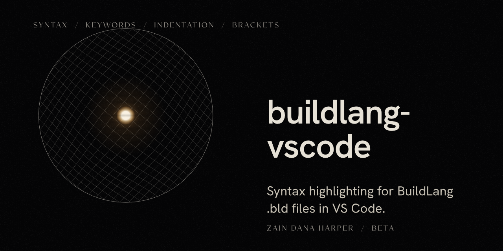

# buildlang-vscode

> This folder moved here from the `HarperZ9/buildlang-vscode` repository on 2026-11-15 (its `main` at commit `c7cc292`). The badges below still point at that repository, which stays in place because the Marketplace listing links to it. This is the syntax-only extension. [`../vscode`](../vscode) is a second extension with snippets and the language-server client.

Syntax highlighting for BuildLang .bld files in VS Code.

```
code --install-extension buildlang-0.1.0.vsix
```

[](https://github.com/HarperZ9/buildlang-vscode/releases/latest)
[](https://github.com/HarperZ9/buildlang-vscode/actions/workflows/ci.yml)
[](https://github.com/HarperZ9/buildlang-vscode/blob/main/LICENSE)

Syntax highlighting and editor configuration for
**[BuildLang](https://github.com/HarperZ9/buildlang)**, an effects-oriented
compiler project with a verified C path, shader output, and experimental
backend research.

## Features

- Syntax highlighting for `.bld` files
- Full keyword coverage - 61 language keywords including the effect system (`with`, `effect`, `handle`, `resume`, `perform`) and AI primitives (`ai`, `neural`, `infer`)
- Smart indentation, bracket matching, and auto-closing pairs
- Comment toggles (`Ctrl+/`)
- File icon for `.bld`

## About BuildLang

BuildLang is an effects-oriented systems language with a multi-backend compiler written in Rust. It compiles to:

- **C** (primary)
- **HLSL**, **GLSL** (shader output)
- **SPIR-V**, **LLVM IR**, **WebAssembly**, **x86-64**, **ARM64**

```build
fn main() ~ Console {
    println!("Hello from BuildLang!");
}
```

## Install

From the Marketplace: **View -> Extensions -> search "QuantaLang"**, click Install. The [Marketplace listing](https://marketplace.visualstudio.com/items?itemName=HarperZ9.quantalang) still carries the earlier name.

From `.vsix` directly:

```bash
code --install-extension buildlang-0.1.0.vsix
```

## Usage

Once installed, the extension activates automatically for any file with the
`.bld` extension - no commands or configuration required. See
**[USAGE.md](USAGE.md)** for what the extension provides, how to verify it is
active, and worked examples (including a sample under
[`examples/`](examples/)).

This extension is editor support only; it provides syntax highlighting and
language configuration. It does not bundle or run the BuildLang compiler. To
build or run `.bld` programs, use the `buildc` toolchain from the
[language repo](https://github.com/HarperZ9/buildlang).

The browser evidence example is an editor fixture only. It documents Telos
workflow vocabulary for highlighting and examples; this package does not compile
or execute browser automation.

## Links

- [Language repo](https://github.com/HarperZ9/buildlang)
- [Grammar](../tmLanguage)
- [Build Universe](../../universe)

## License

MIT. Copyright (c) 2026 Zain Dana Harper.

---

Built by **[Zain Dana Harper](https://harperz9.github.io)**: evidence-first tools that leave a re-checkable artifact behind. The full workbench is at [Project Telos](https://harperz9.github.io).
