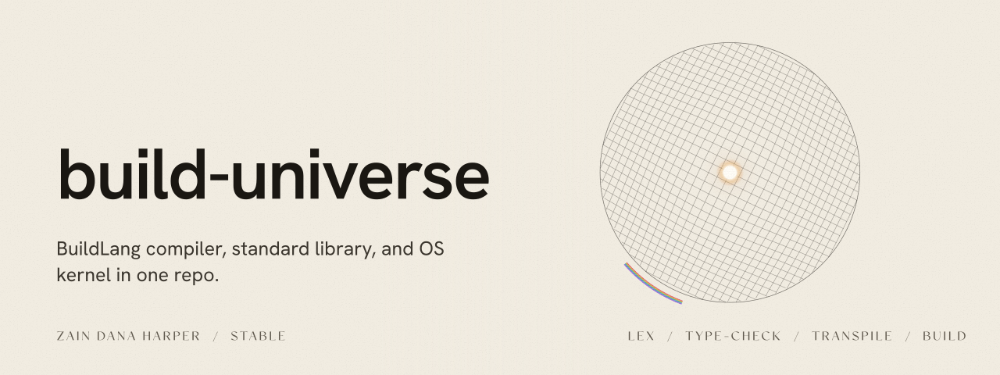

<picture>
  <source media="(prefers-color-scheme: dark)" srcset="docs/art/hero-dark.svg">
  
</picture>

# Build Universe

BuildLang modules and example programs for graphics, colour, finance and systems work, plus a hobby OS kernel.

This tree moved here from the `HarperZ9/build-universe` repository on 2026-11-15 (its `main` at commit `1633fc3`). The compiler is in this repository under [`compiler/`](../compiler), and the Build suite is under [`suite/`](../suite). The compiler figures further down this page were recorded against an earlier compiler version.

**What the current compiler accepts.** CI runs `buildc check` on every `.bld` file in this folder with the compiler of the same commit. With `buildc` 1.15.0 on CI, 81 of 268 files pass. The 187 that fail are listed one by one in [CHECK-FAILS.txt](CHECK-FAILS.txt) with the stage where each stops, and the job fails when that list stops being true. Run it yourself from the repository root:

```bash
bash universe/check.sh compiler/target/release/buildc
```

The `organism` job runs every component in [tools/components.toml](tools/components.toml) on Windows and skips none. The 16 library modules registered for a C build all fail it today; each is marked `xfail` and the job fails when one starts to pass. Issue #290 tracks both lists.

Licence: this folder is licensed under the MIT License ([LICENSE](LICENSE)). The compiler and toolchain in this repository are AGPL-3.0-only.

An alpha compiler ecosystem, mixed-language by design. The pieces are not "all written in BuildLang":

- **BuildLang** is the language, and its `foundation/` standard library and the domain modules (spectrum, delta, oracle, and the rest) are the `.bld` source.
- **The compiler** ([`compiler/`](../compiler) in this repository, Rust; the figures here, ~231K LOC and 612 passing cargo tests, are from an earlier version) lexes, type-checks, and transpiles a `.bld` module to C, which MSVC then builds to a native binary.
- **The OS kernel** (`buildos/`, Rust, ~196K LOC) is a separate hobby kernel, not written in BuildLang.

Self-hosting (the compiler compiling itself from `.bld`) and whole-ecosystem cross-module compilation are **goals, not achievements**. See [STATUS.md](STATUS.md) for the canonical per-module reality and [ARCHITECTURE.md](ARCHITECTURE.md) for how a `.bld` module becomes C.

## Modules

### Core
- **BuildLang** - Multi-paradigm systems language with algebraic effects, ownership, and a production C backend (HLSL/GLSL/LLVM/x86-64/ARM64/WASM/SPIR-V backends exist but are experimental and do not yet emit runnable artifacts)
- **BuildOS** - Hobby OS kernel (x86-64, ext2/4, context switching, memory management)
- **Axiom** - Neural architecture search and differentiable program synthesis

### Graphics
- **Photon** - Game rendering engine with shader injection and SPIR-V support
- **Spectrum** - Color science (ACES, Display P3, Rec.2020, spectral rendering)
- **Chromatic** - Perceptual color spaces (Oklab, JzAzBz, ICtCp, CAM16)
- **Lumina** - Post-processing pipeline
- **Nexus** - Universal mod framework
- **Prism** - Shader collection
- **Refract** - ENB integration
- **Neutrino** - Neural rendering effects

### Finance
- **Quantum Finance** - Algorithmic trading (momentum, mean reversion, stat arb)
- **Field Tensor** - 4D market data structure
- **Delta** - Options pricing and Greeks (Black-Scholes, binomial, Monte Carlo)
- **Entropy** - ML feature engineering and model training

### Integration
- **Entangle** - PC-mobile sync
- **Calibrate** - Display calibration
- **Nova** - Rendering presets

### Intelligence
- **Oracle** - Time-series forecasting (ARIMA, Holt-Winters, anomaly detection)
- **Wavelength** - Media processing

### Tools
- **Forge** - Developer tools (formatter, linter, debugger, profiler)
- **Foundation** - Standard library

## Status

**Alpha.** The BuildLang compiler (Rust; 612 tests pass / 0 fail on `cargo test`, 755 `#[test]` annotations in tree including ignored/multi-bin) is the most mature component. The C backend produces correct native binaries; HLSL/GLSL emit shader text only. The other backends (x86-64, ARM64, WASM, LLVM, SPIR-V) generate output but have no linker/assembler integration, so none produce a runnable artifact yet. The `.bld` modules demonstrate the language's capabilities across domains and double as its specification. See [STATUS.md](STATUS.md) for the per-module maturity ledger and [buildos/STATUS.md](buildos/STATUS.md) for kernel implementation state.

## Caveats

- **This ecosystem does not compile as a whole.** Each module depends on the BuildLang compiler ([`compiler/`](../compiler) in this repository). The compiler can compile individual modules but cross-module resolution is not yet complete.
- **BuildOS** is an educational hobby kernel, not a production OS. See [buildos/STATUS.md](buildos/STATUS.md).
- **Axiom** is an experimental proof-of-concept for differentiable program synthesis.
- The `.bld` source files serve as both working code and language specification - demonstrating BuildLang's syntax across domains.

## Ground Truth

This repo previously carried conflicting claims across README, ENGINEERING, and CHANGELOG. Authoritative per-module reality now lives in:

- [STATUS.md](STATUS.md) - module maturity ledger (real vs scaffolding). Where any doc disagrees, STATUS.md is canonical.
- [ARCHITECTURE.md](ARCHITECTURE.md) - the ecosystem layers and how a `.bld` module becomes a native binary.
- [LINEAGE.md](LINEAGE.md) - the Build family tree and how the mixed-language pieces interlace.
- [CONTRIBUTING.md](CONTRIBUTING.md) - build-from-source steps, how to add a module, and the test/lint gates.
- [docs/ENTERPRISE-READINESS.md](docs/ENTERPRISE-READINESS.md) - what is production-capable vs alpha, and how it fits Project Telos.
- [docs/HEATMAP-AND-ACTION-PLAN.md](docs/HEATMAP-AND-ACTION-PLAN.md) - engineering heatmap and prioritized plan.

## Lineage

Build Universe is the canonical successor to the earlier `quanta-universe` repo (renamed to `build-universe` in June 2026 as part of the `quanta` -> `build` rename). `quanta-universe` holds earlier history only and should not be used for new work. The `build-universe` repository holds the history up to 2026-11-15; development continues in this folder. See [LINEAGE.md](LINEAGE.md) for the full Build family tree.

## License

OSI-approved MIT License (relicensed from FSL-1.1-MIT on 2026-11-26). See [LICENSE](LICENSE).

---

Built by **[Zain Dana Harper](https://harperz9.github.io)**: evidence-first tools that leave a re-checkable artifact behind. The full workbench is at [Project Telos](https://harperz9.github.io).
